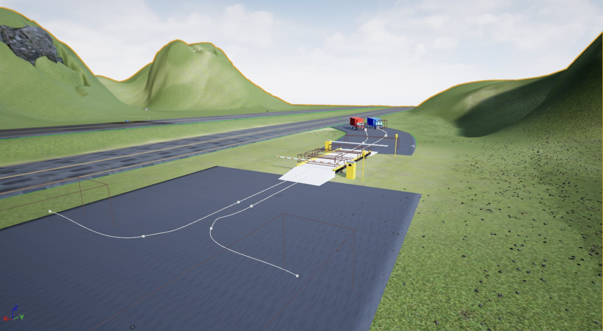
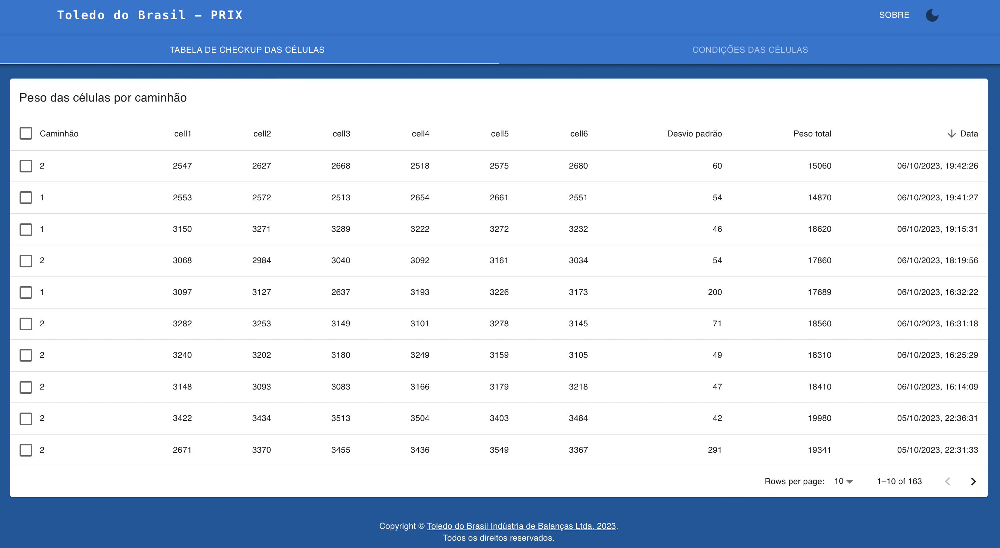
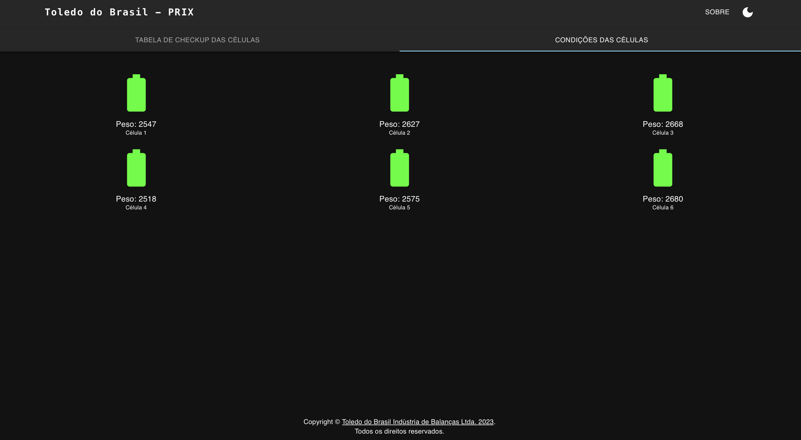
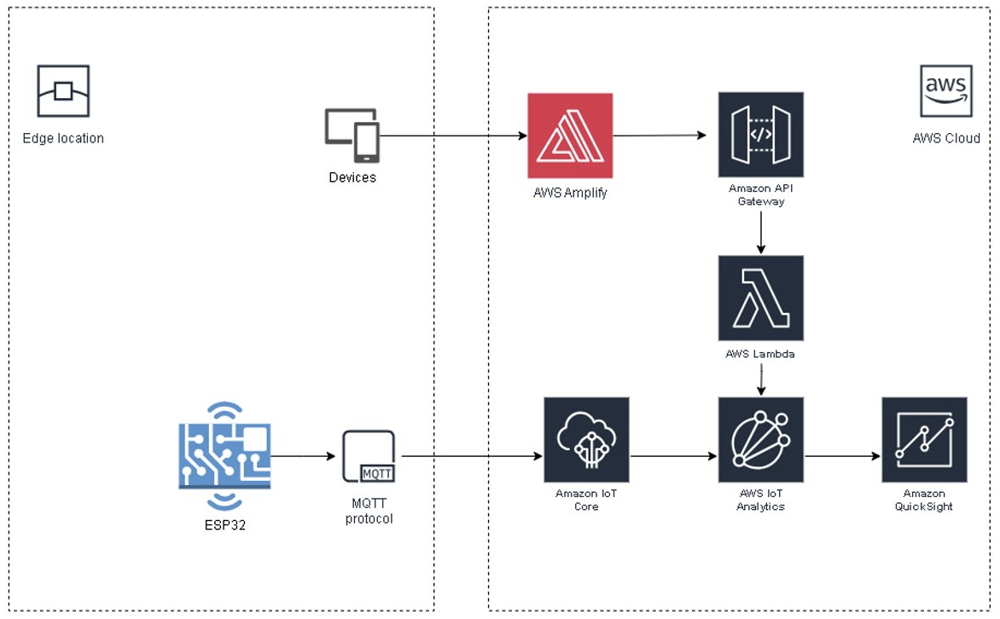
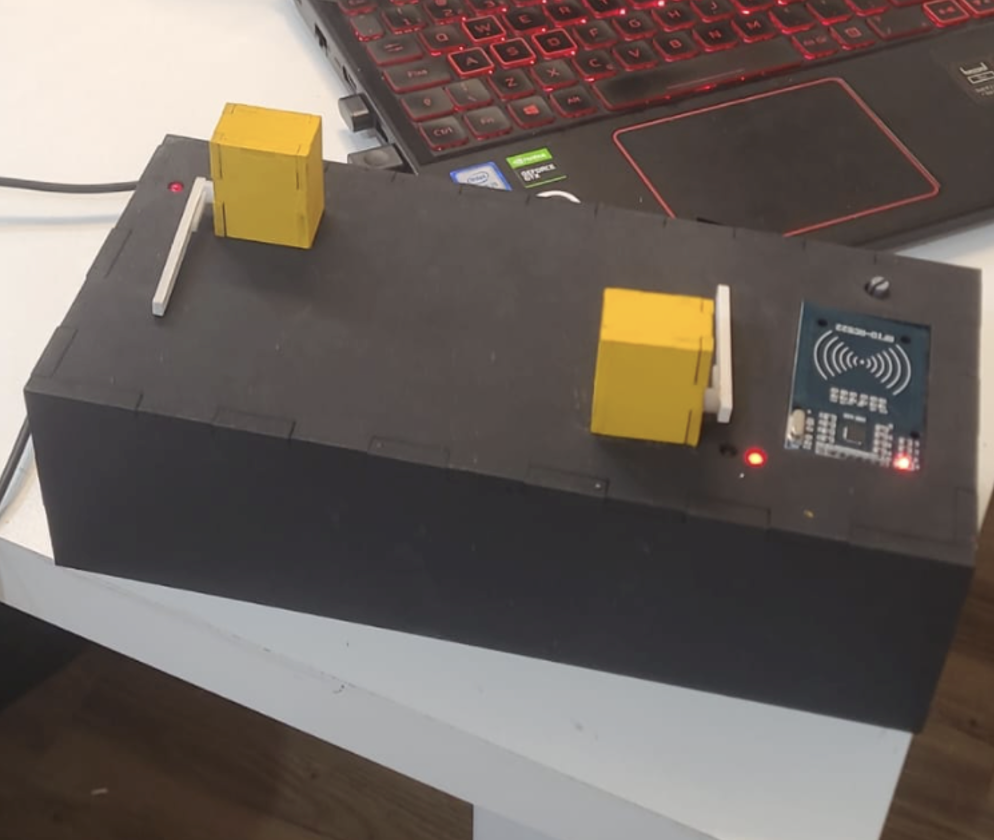

# 🏭 Challenge Toledo | Digital Twin & IoT (2023)

## 📌 Descrição do Projeto

O projeto desenvolvido para o **Challenge Toledo (Toledo do Brasil - PRIX)** consiste na criação de um **Gêmeo Digital (Digital Twin)** de um ambiente de pesagem industrial, unindo tecnologias IoT à robustez da **Amazon Web Services (AWS)**. 

O sistema simula com extrema precisão operações de pesagem num ambiente virtual modelado em **Unreal Engine 5.1.1**, que se mantém sincronizado em tempo real com um protótipo físico baseado em **ESP32**. A comunicação entre o hardware e o motor gráfico é garantida através de comunicação serial, permitindo que operadores e engenheiros realizem testes de stress, otimização de processos e melhorias de eficiência sem necessidade de interação direta com o sistema físico (reduzindo custos e mitigações de risco).

---

## 🚀 Funcionalidades Principais

* 🎮 **Gêmeo Digital (Unreal Engine 5.1.1):** Réplica fiel do sistema físico, permitindo a interação com sensores virtuais, atuadores e painéis de controlo através de um ambiente 3D imersivo.
* ⚙️ **Hardware IoT (ESP32):** Protótipo físico equipado com sensores que simulam o processo real de pesagem, integrando diretamente os dados capturados.
* 🔌 **Comunicação Serial em Tempo Real:** Troca bidirecional de dados entre o ESP32 e o Unreal Engine utilizando o plugin [Serial COM](https://github.com/videofeedback/Unreal_Engine_SerialCOM_Plugin).
* ☁️ **Integração AWS (IoT Analytics & QuickSight):** Envio dos dados de telemetria diretamente do hardware para a nuvem da AWS (AWS IoT Core), redistribuindo a informação para a criação de *dashboards* de análise de dados avançada.
* 🕹️ **Controlo Remoto Bidirecional:** O ambiente virtual pode atuar sobre o hardware físico, alterando parâmetros de forma remota e segura para testes de cenário.

<b>📸 Ver Dashboards e Arquitetura AWS</b> (Clique para expandir)

 

**Dashboards Web:**
| Light Theme | Dark Theme |
| :---: | :---: |
|  |  |

**Arquitetura Cloud:**

---

## 📂 Estrutura de Arquivos

* 📄 `ESP32/ChallengeToledo.ino`: O "cérebro" físico. Código em C++ para o ESP32 responsável pela leitura de sensores, atuação física, comunicação Serial com a Unreal Engine e integração Wi-Fi/MQTT com a AWS.
* 🔐 `ESP32/AWS_IOT/Secrets.h`: Ficheiro de configuração (ignorado no versionamento público) que armazena chaves privadas, certificados (*Amazon Root CA*), *endpoints* do IoT Core e credenciais de rede.
* 📊 `EletronicaChallenge.xlsx`: Mapeamento detalhado e esquemático das ligações elétricas (pinagem de sensores e atuadores ao ESP32). Essencial para a montagem de hardware.
* 📁 `AmbienteVR/`: O projeto completo da **Unreal Engine 5.1.1**. Contém todos os *Blueprints*, texturas, *assets* 3D e a lógica do Gêmeo Digital.

---

## 🛠️ Guia de Instalação e Uso

### 1. Preparação do Hardware (ESP32)
1. Monte o protótipo físico seguindo o mapeamento da planilha `EletronicaChallenge.xlsx`.
2. Configure as credenciais AWS e Wi-Fi no ficheiro `Secrets.h`.
3. Faça o *flash* do código `ChallengeToledo.ino` para o seu microcontrolador ESP32.
*(Verificação de montagem: )*

### 2. Configuração do Gêmeo Digital (Unreal Engine)
1. Instale a versão **5.1.1** da Unreal Engine.
2. Abra a *Engine*, vá a `File > Open Project` e selecione o projeto dentro do diretório `AmbienteVR`.
3. Garanta que o ESP32 está conectado ao computador via USB. No projeto da Unreal, configure o nó do plugin **Serial COM** para apontar para a porta COM correta do microcontrolador.

### 3. Execução e Análise de Dados
Com os dois sistemas a correr, as métricas e interações físicas são refletidas no ambiente 3D. Os dados agregados podem ser consultados nos Dashboards do **AWS QuickSight**:
* 📉 [Análise: Weight Truck](./images/WeightTruck.png)
* 📉 [Análise: Weight Cell](./images/WeightCell.png)
* 📉 [Análise: Weight Cell Pair](./images/WeightCellPair.png)

---

## 👥 Equipa de Desenvolvimento
Projeto desenvolvido como trabalho académico do 4º ano de **Engenharia da Computação** na FIAP (2023).

| Nome | RM | Turma |
| :--- | :--- | :---: |
| Carlos Henrique Neves Júnior | 82378 | 4ECR |
| Felipe Gabriel Correa da Silva | 85487 | 4ECR |
| Guilherme Rosa Campanha | 84162 | 4ECR |
| Isabela Brito Pessoa | 85912 | 4ECR |
| Leandro de Jesus Luna | 86492 | 4ECA |
| Marcos Moura dos Santos | 86507 | 4ECR |
| **Fabbio Augusto Boli** | **84695** | **-** |

---

## 📬 Contacto & Agradecimentos
Para questões técnicas ou operacionais sobre a arquitetura do projeto:
📧 **Fabbio Boli:** fabinho871@live.com

Um especial agradecimento à **Toledo do Brasil (PRIX)** pelo desafio e parceria com a **FIAP**, bem como a todos os professores e mentores que orientaram a equipa durante o percurso tecnológico!
